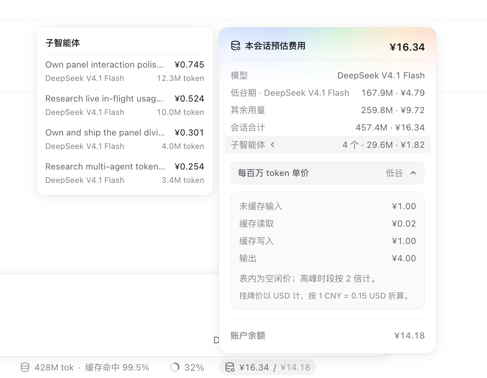

# dsh-token-billing



在 DeepSeek Harness 的 dock 行显示本会话花了多少钱（¥）。悬停看摘要，点击展开明细。

## 解决什么问题

**DSH 告诉你用了多少 token，但不告诉你花了多少钱** —— 而这个换算并不直观：缓存读取比未缓存输入便宜两个量级，高峰时段单价翻倍，不同模型之间差几十倍。只看 token 数字判断不出「这一趟贵不贵」。

**开了多智能体之后更明显**：子智能体和 teammate 是**独立会话**，父会话的用量里不包含它们，主界面上那个数字会系统性地低于真实花费，用得越多偏得越远。

这个插件把 token 折算成钱，并把整棵会话树的花费算进来。

## 显示什么

- **胶囊**（dock 行）—— `¥16.34 / ¥14.18`：本会话预估费用 / 账户余额。余额可点，跳到官方用量页。会话运行中末尾有一个绿色呼吸点。
- **本次花费** —— 同一行追加上 `本次 5.6M tok 花费 ¥0.195`，即本轮对话自己的消耗，跑完仍留在那里。
- **明细面板**（点击胶囊）—— 按**时段与模型**分行（`低谷期 · DeepSeek V4.1 Flash 167.9M · ¥4.79`），然后是本次、会话合计、子智能体。
- **子智能体卡片** —— 点 `子智能体` 一行展开，逐个列出 agent 的描述、花费、模型与 token。
- **单价表** —— 默认收起，展开看四个计费桶的每百万 token 单价。

## 价格怎么算

**逐请求归因**：每个请求按**它自己发生的时间**判峰谷、按**它当时真实的模型**取单价，而不是拿会话最后的状态去套全部历史。

| | |
| --- | --- |
| 峰谷 | 挂牌价即**空闲价**；北京时间工作日 09:00–12:00、14:00–18:00 为高峰，按 2 倍计 |
| 桶 | 未缓存输入 / 缓存读取 / 缓存写入 / 输出，各自单价 |
| 跨时段 | 一次对话横跨整点也只按各自时段算，不会整段重算 |
| 换模型 | 会话中途换过模型，各自按当时的模型计价 |
| 子智能体 | 各自按自己的模型计价后汇总进总数 |
| 汇率显示 | 表价以 USD 计，按 1 CNY = 0.15 USD 折算 |

## 是估算，不是账单

价格表来自 [models.dev](https://models.dev) 的公开挂牌价，可能与你的实际计费口径不同。已知残留：

- **更早的历史**：客户端只能看到会话的分页窗口，窗口之外的请求拿不到时间与模型，按当前路由估算，面板里显示为 `其余用量`；
- **价格表时效**：软过期 24 小时（先用旧值、后台刷新），硬过期 7 天。官方调价后最多 7 天内仍按旧价；
- **非 DeepSeek 路线**：按上面的固定汇率折算，与真实结汇价可能有几个百分点的差。

有这些误差在，请把它当估算，别当账对。

## 会不会破坏什么

不会。它不改不写任何会话内容：

| | 做了什么 |
| --- | --- |
| 注册 | dock 行**一个槽位**（`conversation.composer.dock`）+ Host 侧**一个只读路由** `/plugins/dsh-token-billing/balance` |
| 读取 | 会话投影里的 token 用量与模型路由、会话轨迹、子智能体目录 |
| 写入 | 一个 `<style>` 标签（停用时移除）+ 两个 storage key（价格表缓存、本轮基线，都可随时删） |
| 网络 | 只有两个：models.dev 取公开价目表、DeepSeek 官方 `user/balance` |
| 不碰 | 你的会话内容、DSH 内核、其他插件；Host 半边零运行时 import |

**API key 不进浏览器** —— 余额请求由 Host 半边代发，用的是 Host 凭据库里的 key，浏览器只拿到数字。那个路由带信任围栏：只接受 loopback 或受信 host，拒绝跨站的 `sec-fetch-site`，并校验 `origin`，所以网页里的第三方站点借不到它去读你的余额。

卸载或禁用后槽位、路由、样式标签都随之移除。

## 安装

在 DSH 的「添加插件」里填仓库地址：

```
https://github.com/eivmosn/dsh-token-billing
```

或命令行：

```bash
dsh plugin add github:eivmosn/dsh-token-billing
```

仓库已带构建好的 `lib/`，安装不需要编译、不需要放行构建脚本、也不会装 devDependencies。

## 开发

```bash
pnpm install
pnpm dev      # tsdown --watch
pnpm check    # typecheck → oxlint → build → test
```

TypeScript + tsdown + oxlint + vitest。Host 半边是不含任何运行时 import 的 ESM；client 半边是浏览器 CJS 闭包工厂；样式写在真实 `.css` 文件里，构建期内联进 bundle；界面文案走 DSH 的 locale 服务，中英各一份。

改了 `src/` 请跑一次 `pnpm check` 再提交 —— 它内含构建，会刷新被跟踪的 `lib/`。

## License

MIT
